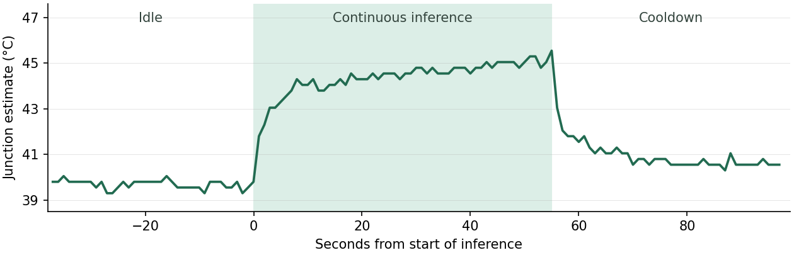

# Coral USB hwmon

Read the die temperature of a **Google Coral USB Accelerator** with `sensors`, or show it directly in Frigate. This out-of-tree Linux kernel module uses the stock Coral firmware and runtime. A DKMS package installs on the host, including when Frigate runs in Docker.

```console
$ sensors 'coral_usb-*'
coral_usb-virtual-0
Adapter: Virtual device
temp1:        +40.3°C
```

## Install on Debian or Raspberry Pi OS

1. Install the development headers matching your **running kernel**. Check that `/lib/modules/$(uname -r)/build/Makefile` exists.
2. Download the `.deb` from [Releases](https://github.com/JonMagon/coral-usb-hwmon/releases/latest).
3. Install the package and load the module. The included udev rule loads it automatically when a Coral subsequently appears in runtime mode.

```sh
sudo apt install ./coral-usb-hwmon-dkms_0.1.1_all.deb lm-sensors
sudo modprobe coral_usb_hwmon
sensors 'coral_usb-*'
```

Start your usual Edge TPU application once after plugging the accelerator in. The sensor appears when the firmware enumerates as `18d1:9302`. The bootloader has USB ID `1a6e:089a`.

To see which clock rate the runtime selected while your application is running, use the [standalone probe with `--clock`](docs/hardware.md#read-the-configured-tpu-clock).

## Show the temperature in Frigate

On hosts with **USB Coral accelerators only**, enable the optional apex compatibility class. Frigate can then read the temperature from its usual sysfs path, including from the stock container.

```sh
echo 'options coral_usb_hwmon apex_compat=1' | sudo tee /etc/modprobe.d/coral-usb-hwmon.conf
# Reload to apply the new option if the module is already running.
if [ -d /sys/module/coral_usb_hwmon ]; then sudo modprobe -r coral_usb_hwmon; fi
sudo modprobe coral_usb_hwmon
cat /sys/class/apex/apex_0/temp
```

A reading of `40300` means **40.3 °C**. In Frigate 0.18.0 the detector's next stats update includes its `temperature` field under `/api/stats`.

| Interface | Availability | Unit |
| --- | --- | --- |
| `/sys/class/hwmon/hwmonN/temp1_input` | Default. Find the entry whose `name` is `coral_usb`. | Millidegrees Celsius |
| `/sys/class/apex/apex_N/temp` | With `apex_compat=1`. Intended for USB-only installations. | Millidegrees Celsius |

Google's PCIe driver uses the same `apex` class name. On systems with a PCIe Coral, keep `apex_compat` off and use `hwmon` for the USB sensor. With multiple USB units, indices follow attachment order. Frigate versions that associate detectors by index can show a different unit's reading.

## Hardware validation

On a Raspberry Pi with a USB Coral, 6,677 inferences over 55 seconds raised the median junction estimate from **39.80 °C to 45.05 °C** during the last ten seconds of load. It fell to **40.55 °C** in the final ten seconds of cooldown. The temperature conversion uses Google's PCIe calibration. This experiment checked the response to load and did not independently calibrate the absolute temperature.



The DKMS module was also tested with Frigate 0.18.0 on kernel `6.6.31+rpt-rpi-2712`, including module reload, runtime-device unbind/rebind and detector restart. See [hardware notes and measurements](docs/hardware.md) for the register sequence and raw ADC series.

## Build from source

For a local build against matching, configured kernel headers:

```sh
make
sudo insmod ./coral_usb_hwmon.ko
```

To build the distributable DKMS package on Debian:

```sh
sudo apt install dpkg-dev debhelper dh-dkms
dpkg-buildpackage -us -uc -b
```

The `_all.deb` in the parent directory contains the source. DKMS compiles a module for each target kernel on the machine where you install it.

## Uninstall

```sh
sudo modprobe -r coral_usb_hwmon
sudo apt purge coral-usb-hwmon-dkms
```

Remove `/etc/modprobe.d/coral-usb-hwmon.conf` if you created it for Frigate.

## License

[GNU General Public License, version 2 only](COPYING). Independent community project.
